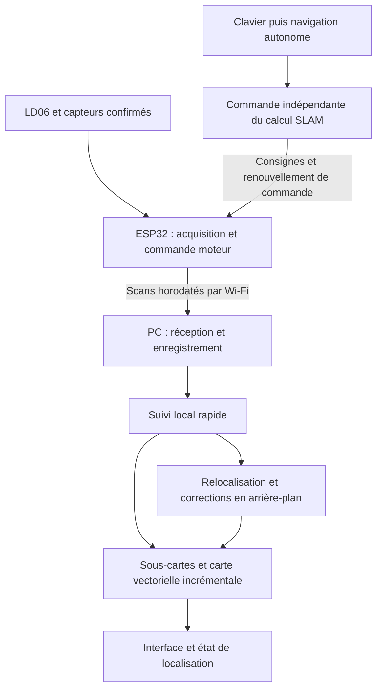

> **Note (interface web).** Les écrans, onglets et fichiers Tkinter cités ici (`app.py`, `interface_wifi.py`, `interface_tp.py`…) ont été remplacés par l'interface web : voir [GUIDE_WEB.md](GUIDE_WEB.md). Les principes, calculs et résultats décrits restent valables.

# Vers un robot de cartographie vectorielle en temps réel

Étude du 3 novembre 2026. **Statut : choix d’architecture et plan d’intégration.** Cette étape ne remplace pas encore le solveur de l’application et n’ajoute pas de commande moteur active. Les fonctionnalités déjà implémentées restent décrites dans LOCALISATION_GLOBALE.md.

## Objectif confirmé

Première étape : piloter le robot au clavier depuis l’application, transmettre en Wi-Fi les scans acquis pendant son déplacement et construire progressivement une carte vectorielle de la pièce. Deuxième étape : choisir des déplacements automatiquement, explorer les zones inconnues et éviter les obstacles.

Le PC conserve le calcul SLAM, la carte et l’interface ; l’ESP32 lit le LD06, transmet les données et assure le pilotage matériel. Nous conservons Python/Tkinter pour le TP. Une migration ROS 2 complète n’est pas retenue comme préalable ; des outils ROS pourront servir de référence de comparaison.

## Audit initial et ajout du code moteur

La branche main du dépôt ScanAtlas a été vérifiée au commit 2f9ba1f8783afb26808372aafb335914ec6e238c : elle contient l’application PC, pas de fichier .ino, de projet PlatformIO ou de firmware moteur/Wi-Fi. L’utilisateur confirme ensuite que seul le test LD06 est disponible.

L’archive ESP32_LD06_Test fournie précédemment contient un exemple fondé sur Robot-Maker-SAS/LD06 : réception sur Serial2, GPIO33, UART lidar à 230400 bauds, activation/PWM lidar sur GPIO32, tampon RX 4096 octets. Dans cette copie, la sortie principale est Teleplot à 115200 bauds ; l’exemple CSV est dans un bloc commenté. Cela ne prouve pas que le programme actuellement flashé est identique à cette archive. Ni commandes moteurs, ni Wi-Fi, ni odométrie de roues ne sont présents dans cet exemple.

Mise à jour après le nouvel import GitHub : le dossier MecanumCarV2 est maintenant disponible au commit f6fd48217761220557d9b3670f7f37935af385cd. Le README identifie un Keyestudio Mecanum Car V2 et le programme ESP32MecanumCar.ino utilise mecanumCar(19, 21), avec SDA 19 et SCL 21. Les appels Advance, Back, L_Move, R_Move, Turn_Left, Turn_Right et Stop sont présents dans une démonstration temporisée non bloquante. Ce programme ne contient pas encore de Wi-Fi ni de liaison au logiciel PC. Le test LD06 nouvellement importé active désormais printScanCSV. L’existence d’encodeurs et d’une IMU reste à confirmer. Nous ne reprenons pas les informations d’autres TPs pour inventer le câblage de ce robot. Les champs odométrie et IMU resteront explicitement absents tant que ces capteurs ne sont pas confirmés.

## Pourquoi la version actuelle est lente

La recherche globale est conçue pour retrouver une pose inconnue sur toute la carte et sur 360°. Elle convient au repositionnement du robot et au raccordement hors ligne, mais son exécution à chaque scan entraîne un coût excessif pour suivre un mouvement continu.

Le CSV localisation_globale_lot.csv mesure environ 93,74 s pour sept recalages : médiane 12,13 s, moyenne 13,39 s dans l’environnement d’essai chargé. À 10 tours/s, un tour dure 100 ms. Ces mesures ne prouvent pas la performance sur le PC de l’utilisateur, mais suffisent à montrer que cette stratégie n’est pas actuellement temps réel.

Deux autres coûts croissent : la reconstruction des champs de distance et des espaces libres, et la comparaison avec une carte de points toujours plus grande. Pour la carte vectorielle, reconstruire tous les segments et toutes leurs fusions après chaque réception ferait aussi croître le travail inutilement.

## Projets consultés et idées retenues

| Projet ou documentation | Ce que la source apporte | Adaptation retenue pour ScanAtlas |
| --- | --- | --- |
| CSM et laser_scan_matcher [1] | Recalage incrémental 2D, ICP point vers droite adapté aux télémètres. | Évaluer un suivi local point vers droite avec perte robuste, estimation du mouvement et contrôle de géométrie. CSM n’est pas un système complet de cartographie ou de navigation. |
| KISS-ICP [2] | Le code prédit le prochain départ par la dernière pose et le dernier mouvement ; il entretient une carte locale et des seuils adaptatifs. | Reprendre ces principes en 2D. Le projet traite de l’odométrie lidar 3D ; ce n’est pas un module LD06 directement interchangeable. |
| Cartographer [3] | Séparation entre SLAM local et tâches globales en arrière-plan ; sous-cartes, filtrage spatial et sélection des scans selon le mouvement. | Suivi rapide sur une sous-carte active ; recherche globale, groupes et boucles en tâche de fond. Le premier scan continue à définir le repère global. |
| Line Segment Mapping et CAE-RLSM [4] | Cartographie de segments en ligne et fusion des segments redondants ; extraction par croissance de régions. | Mise à jour des murs par segments nouveaux et observations associées, au lieu de reconstruire la carte entière. Le dépôt s’appuie sur ROS/Karto/g2o ; il n’est pas intégré directement à Tkinter. |
| SLAM Toolbox [5] | Graphe de poses, sous-systèmes de localisation/cartographie, modes synchrones et asynchrones, sauvegarde de la carte et des poses. | Séparer état du suivi, images clés, corrections de trajectoire et rendu. Conserver les observations pour réviser une carte après correction. Référence possible pour comparer les résultats sous ROS 2. |
| BreezySLAM [6] | Interface Python vers un cœur de SLAM en C produisant une carte raster. | Candidat de comparaison pour la vitesse d’une chaîne légère ; ne fournit pas la carte vectorielle finale demandée. Il n’est pas retenu comme cœur principal à cette étape. |

Aucun code de ces projets n’a été copié ou installé dans l’application lors de cette étude. Les choix ci-dessus sont des propositions de développement, pas des performances obtenues sur le robot. Conserver les références et vérifier les licences avant toute reprise de code.

## Architecture retenue

### Suivi local et récupération globale

Le suivi local estime de petits mouvements entre scans rapprochés dans le temps. Il utilise une prédiction issue du mouvement déjà observé ; une vraie odométrie de roues ou une IMU pourra ensuite l’améliorer si le robot en dispose. Une consigne moteur ne sera jamais traitée comme une mesure exacte du mouvement.

Le recalage point vers droite utilise les surfaces locales, plutôt que de forcer chaque point à rejoindre un impact discret. Une recherche de voisins indexée et une carte locale bornée doivent réduire les comparaisons. Les seuils pourront s’adapter au bruit et à l’incertitude, avec bornes contrôlées et mesures enregistrées pour les évaluer.

Les limites locales de calcul ne deviennent pas une limite imposée à l’utilisateur : si le suivi est perdu, le logiciel passe en relocalisation globale 360°, garde les mesures en attente et n’insère pas une pose douteuse. La recherche globale ne tourne plus pour chaque scan correctement suivi. Les états visibles seront Suivi, Relocalisation et Perdu, accompagnés de la concordance et de l’âge de la dernière pose valide.

La carte d’ensemble reste ancrée au premier scan. La sous-carte locale n’est qu’un accélérateur du suivi. Des images clés sont conservées selon le déplacement, la rotation, le temps ou la nouveauté de la zone, avec réglages automatiques à évaluer. Les scans bruts utiles au rejeu ne sont pas supprimés en fonction de leur nombre de points.

### Carte vectorielle incrémentale

Pour chaque scan accepté : extraire les segments dans l’ordre angulaire des mesures, conserver les ruptures et les limites de tours, transformer les segments dans le repère de la sous-carte, puis chercher seulement les segments voisins concernés par la mise à jour.

Une fusion doit vérifier l’angle, l’écart perpendiculaire, la continuité des projections et les observations de support. Elle ne doit pas relier deux murs simplement parce qu’ils sont proches, ni fermer une porte sans observation. Les segments provisoires et les murs confirmés doivent être distingués pour ne pas figer une personne mobile dans le plan de la salle.

Conserver les points de support, les poses et les sous-cartes à l’origine de chaque mur permet de recalculer les parties affectées après une correction de trajectoire. Une simple moyenne définitive de segments globaux serait difficile à corriger. Une carte d’occupation interne reste utile pour les espaces libres, les obstacles non linéaires et, plus tard, la navigation ; elle complète la sortie vectorielle.

### Réception et affichage indépendants

La réception réseau et la commande moteur doivent rester réactives quand le SLAM calcule. Prévoir des files bornées, une mesure de l’âge des données et un mode de traitement du dernier scan disponible pour éviter une file de plusieurs minutes. L’enregistrement des données brutes sera séparé et les pertes éventuelles comptées explicitement ; ne pas promettre une conservation intégrale sans tester le débit disque et réseau.

Le rendu de l’interface n’a pas besoin de reconstruire tous les tracés au rythme des tours lidar. Réutiliser les objets graphiques ; mettre à jour les murs modifiés et la pose. Les tâches globales lourdes devront tourner dans un processus distinct et publier des résultats versionnés, applicables seulement si les données utilisées sont encore valides.

## Wi-Fi et acquisition en mouvement

Choix de départ : deux connexions TCP sur le réseau local, une pour les commandes/états et une pour les scans binaires. Les classes réseau natives Arduino-ESP32 conviennent à cette organisation [7]. Des WebSockets restent une alternative si l’on veut ensuite un client navigateur. La version du framework doit être fixée et la compatibilité vérifiée avant compilation.

Le protocole devra porter au minimum : version, identifiant de session et de scan, horodatage monotone ESP32, durée du scan, nombre de points, angles, distances, intensités, compteurs de pertes et état matériel. L’odométrie et l’IMU sont optionnelles et identifiées comme absentes lorsqu’elles n’existent pas. Les unités et le repère lidar doivent être explicites ; conserver le zéro lidar choisi dans l’application.

À titre de dimensionnement, 450 points/tour à 10 tours/s représentent 4500 points/s. Une proposition à 7 octets/point (angle, distance, intensité, temps relatif) représente 31 500 octets/s de charge utile, auxquels ajouter les en-têtes. Un UART à 115200 bauds en 8N1 fournit au maximum théorique 11 520 octets/s : il ne pourrait pas transporter ce format à ce rythme. Ce calcul n’est pas une mesure de débit du montage et n’explique pas à lui seul les anciens nombres de points observés. Le Wi-Fi et un format compact évitent ce goulet, à condition de ne pas bloquer la lecture UART du lidar pendant l’émission.

Le robot bouge pendant un tour : à 10 Hz, les points s’étalent sur environ 100 ms. Les scans ne sont donc pas des photographies instantanées. Il faudra horodater les observations et corriger cette déformation à partir d’un mouvement estimé quand celui-ci sera disponible [3]. Démarrer à faible vitesse permet de caractériser l’effet ; cela ne remplace pas la compensation du mouvement. Les horodatages lidar doivent être remis dans une base de temps monotone avec gestion des retours à zéro, pas utilisés naïvement comme une horloge PC.

## Pilotage et autonomie

Étape téléopération : touches maintenues pour avancer/reculer/tourner, relâchement pour s’arrêter, arrêt explicite à la perte de focus ou à la fermeture de l’application. Le sens des commandes, la cinématique et les limites de vitesse dépendront du châssis et du driver réellement identifiés. Ajouter la translation latérale seulement si le châssis le permet.

Un délai d’expiration de commande géré sur l’ESP32 doit arrêter le robot si les commandes ne sont plus renouvelées. Point de départ à tester : renouvellement 10–20 Hz et expiration 300 ms. Ces valeurs sont des choix proposés, pas une fonction déjà présente ni une distance d’arrêt garantie. L’arrêt ne doit pas dépendre du thread SLAM ou du rafraîchissement Tkinter. Tester d’abord les roues dégagées du sol et vérifier une déconnexion Wi-Fi.

Étape autonomie : d’abord atteindre une destination choisie par l’utilisateur sur une carte connue ; ensuite explorer les frontières entre zones libres connues et inconnues. Utiliser la géométrie réelle du robot, une marge autour des obstacles, un planificateur et un évitement local fondé sur les mesures récentes. Nav2 constitue une référence d’architecture pour les cartes de coûts, l’empreinte du robot et un contrôle anticollision séparé [8]. Une carte vectorielle de murs seule ne couvre pas tous les obstacles et toutes les incertitudes.

## Jalons et validation

| Jalon | Résultat attendu | Vérification concrète |
| --- | --- | --- |
| 1. Rejeu enregistré | Même séquence pour comparer les méthodes sans déplacer le robot. | Erreurs sur simulation, concordance, faux raccordements, temps médian/P95 et croissance mémoire. |
| 2. Suivi local et segments incrémentaux | Suivi fluide sans recherche globale systématique. | Objectif initial : suivi à 5 Hz avec P95 inférieur à 200 ms ; viser ensuite 10 Hz et un budget de 100 ms. Ce sont des objectifs à mesurer. |
| 3. Lidar Wi-Fi seul | Flux continu, horodaté et récupérable après reconnexion. | Débit, âge des scans, pertes/duplications, contrôle de la mémoire pendant dix minutes. |
| 4. Clavier et moteur | Commande réactive pendant acquisition et calcul. | Sens et échelle des consignes, relâchement, perte de focus, déconnexion et expiration de commande mesurée. |
| 5. Cartographie de la pièce | Carte vectorielle produite pendant un trajet manuel puis sauvegardée. | Murs/dimensions comparés aux mesures, portes préservées, dérive aller-retour et comportement devant des personnes. |
| 6. Navigation puis exploration | Atteindre une destination puis explorer sans intervention continue. | Obstacles nouveaux, localisation perdue, réseau coupé, zones inaccessibles et arrêt sur données trop anciennes. |

L’ordre proposé évite de confondre une carte qui s’affiche avec un robot capable de naviguer. Il n’est pas nécessaire de tout migrer sous ROS pour commencer, mais il faut mesurer les performances et les défauts plutôt que multiplier les réglages de l’ICP.

## Sources consultées

Toutes consultées le 3 novembre 2026, sources des auteurs ou documentation officielle.

1. Andrea Censi, CSM : https://github.com/AndreaCensi/csm ; déclaration point-vers-droite : https://github.com/AndreaCensi/csm/blob/master/package.xml ; intégration incrémentale : https://github.com/CCNYRoboticsLab/scan_tools/blob/indigo/laser_scan_matcher/src/laser_scan_matcher.cpp
2. PRBonn, KISS-ICP : https://github.com/PRBonn/kiss-icp ; prédiction et carte locale dans https://github.com/PRBonn/kiss-icp/blob/main/cpp/kiss_icp/pipeline/KissICP.cpp
3. Cartographer, Algorithm walkthrough : https://google-cartographer-ros.readthedocs.io/en/latest/algo_walkthrough.html
4. NKU-MobFly-Robotics, Line Segment Mapping : https://github.com/NKU-MobFly-Robotics/line_segment_mapping ; J. Wen et al., CAE-RLSM, IEEE TIM 69(7), 4222–4237, 2020, référence fournie par le dépôt.
5. Steve Macenski, SLAM Toolbox : https://github.com/SteveMacenski/slam_toolbox
6. Simon D. Levy, BreezySLAM : https://github.com/simondlevy/BreezySLAM
7. Espressif, Arduino-ESP32 Network API : https://docs.espressif.com/projects/arduino-esp32/en/latest/api/network.html
8. Nav2, Costmap 2D : https://docs.nav2.org/jazzy/configuration_and_development/configuration_guide/core_servers/costmap_2d/ ; Collision Monitor : https://docs.nav2.org/jazzy/configuration_and_development/configuration_guide/core_servers/collision_monitor/configuring_collision_monitor_node/
9. Robot-Maker-SAS, bibliothèque à l’origine du test LD06 fourni : https://github.com/Robot-Maker-SAS/LD06
